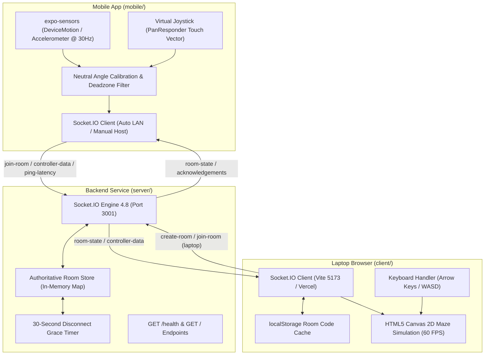
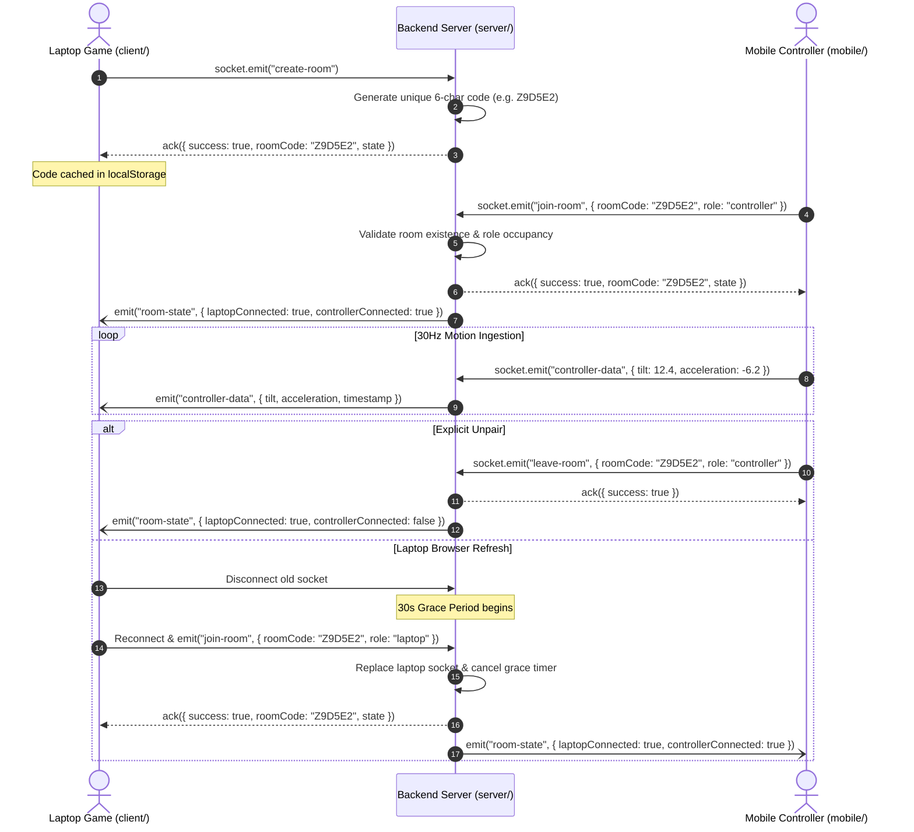

# Anything but a Game Controller

> A real-time arcade maze game where your smartphone transforms into an experimental motion controller, navigating a ball through multi-tiered labyrinth arenas with ultra-low latency.

---

## Table of Contents

1. [Project Overview](#1-project-overview)
2. [Architecture & Data Flow](#2-architecture--data-flow)
3. [Project Structure](#3-project-structure)
4. [Prerequisites](#4-prerequisites)
5. [Local Operation: Windows Laptop](#5-local-operation-windows-laptop)
6. [Local Mobile Operation with Expo Go](#6-local-mobile-operation-with-expo-go)
7. [Web Operation: Deployed Production Application](#7-web-operation-deployed-production-application)
8. [Environment Variables](#8-environment-variables)
9. [Render Backend Deployment](#9-render-backend-deployment)
10. [Vercel Frontend Deployment](#10-vercel-frontend-deployment)
11. [Room Management & Game Mechanics](#11-room-management--game-mechanics)
12. [Motion Calibration & Sensor Processing](#12-motion-calibration--sensor-processing)
13. [Troubleshooting Guide](#13-troubleshooting-guide)
14. [Testing & Verification](#14-testing--verification)
15. [Security & Contribution Guidelines](#15-security--contribution-guidelines)

---

## 1. Project Overview

**Anything but a Game Controller** is an interactive physics game designed around physical motion peripherals. The player guides a ball through a wall-constrained maze from the starting tile to the exit portal. Rather than relying on a traditional gamepad or keyboard alone, players can pair their smartphone to steer the ball using physical device tilting or an on-screen tactile virtual joystick.

### Core Objectives & Gameplay
- **Objective**: Navigate the ball through the maze to reach the glowing exit beacon in the shortest time possible without getting trapped by deceptive branches.
- **Physics Mechanics**: Continuous 2D rigid-body simulation with velocity accumulation, friction, momentum dampening, and 8-point perimeter collision detection against maze walls.
- **Multi-Tier Difficulty**: Three verified solvable maze arenas (Easy: $15 \times 15$, Hard: $17 \times 17$, Expert: $19 \times 19$) featuring deep branching corridors and per-difficulty personal best time tracking.
- **Dual Control System**: Seamless keyboard controls (`W A S D` or arrow keys) active at all times, automatically augmented by real-time phone motion or touch joystick when paired.

### Component Roles
- **Frontend (`client/`)**: High-performance React 19 + Vite 6 web application rendering a 60 FPS HTML5 Canvas game, stage HUD, room code generator, QR code pairing card, and telemetry viewer.
- **Backend (`server/`)**: Authoritative Node.js + Express + Socket.IO real-time server managing in-memory room lifecycles, connection handshakes, role enforcement, 30-second disconnect grace periods, and bi-directional message forwarding.
- **Mobile Controller (`mobile/`)**: React Native + Expo SDK 57 + TypeScript app running in Expo Go or as a standalone app, capturing high-frequency accelerometer/gyroscope readings at 30Hz with resting-angle calibration and a non-scrolling touch joystick.

### Technology Stack
- **Languages**: JavaScript (ES modules and CommonJS), TypeScript, HTML5, CSS3.
- **Frontend**: React 19, Vite 6, `qrcode.react`, Canvas 2D API.
- **Backend**: Node.js 18+ (tested on v22), Express 4, Socket.IO 4.8, CORS, Dotenv.
- **Mobile**: React Native 0.86, Expo SDK 57, `expo-sensors`, `expo-router`, `@react-native-async-storage/async-storage`, `socket.io-client`.
- **Testing**: Node.js native test runner (`node:test`, `node:assert/strict`), ESLint.

---

## 2. Architecture & Data Flow



---

## 3. Project Structure

The project is organized as a monorepo containing three distinct applications:

```text
anything-but-a-game-controller/
├── client/                     # Laptop Web Application (React 19 + Vite 6)
│   ├── public/                 # Static assets and icons
│   ├── src/
│   │   ├── App.jsx             # Main maze game engine, canvas loop, and pairing sidebar
│   │   ├── App.css             # Dark gaming UI stylesheet (graphite, lime, cyan)
│   │   ├── Controller.jsx      # In-browser web controller fallback (/controller)
│   │   ├── Controller.css      # Web controller styling
│   │   ├── index.css           # Global CSS reset and typography
│   │   └── main.jsx            # React root mounting and route switching
│   ├── .env.example            # Client environment variable template
│   ├── .gitignore              # Client build artifact exclusions
│   ├── eslint.config.js        # ESLint flat configuration
│   ├── index.html              # HTML entry point titled 'Anything but a Game Controller'
│   ├── package.json            # Client dependencies and Vite scripts
│   ├── vercel.json             # Vercel SPA routing rewrite rules
│   └── vite.config.js          # Vite configuration (server.host: true, port: 5173)
├── server/                     # Real-Time Backend Service (Node.js + Socket.IO)
│   ├── test/
│   │   └── pairing.test.js     # 12 automated integration tests for room and socket flows
│   ├── .env.example            # Server environment variable template
│   ├── .gitignore              # Server exclusions
│   ├── package.json            # Server dependencies, scripts (node --watch, node --test)
│   └── server.js               # Express app, Socket.IO handlers, CORS, and room store
├── mobile/                     # Smartphone Controller Application (Expo SDK 57)
│   ├── assets/                 # App icons, splash screens, and images
│   ├── src/
│   │   ├── app/
│   │   │   ├── _layout.tsx     # Root Expo Router navigation stack
│   │   │   └── index.tsx       # Controller UI (pairing card & dedicated HUD)
│   │   ├── components/
│   │   │   ├── SensitivitySlider.tsx   # Motion sensitivity multiplier stepper
│   │   │   ├── ServerConfigModal.tsx   # In-app IP configuration and /health test modal
│   │   │   ├── StatusHeader.tsx        # Top status bar with brand and connection pills
│   │   │   ├── TiltVisualizer.tsx      # Dual-axis tilt meter and horizon crosshair
│   │   │   ├── TroubleshootingModal.tsx # In-app help dialog with network tips
│   │   │   └── VirtualJoystick.tsx     # 176px circular non-scrolling touch thumbstick
│   │   ├── constants/
│   │   │   └── theme.ts        # Dark palette design tokens (Colors, Spacing, Radii)
│   │   ├── services/
│   │   │   ├── config.ts       # Host resolution, AsyncStorage caching, LAN detection
│   │   │   ├── sensorService.ts# High-frequency DeviceMotion/Accelerometer manager
│   │   │   └── socketService.ts# Socket.IO connection and room lifecycle manager
│   │   └── types/
│   │       └── index.ts        # Shared TypeScript interfaces and union types
│   ├── .env.example            # Mobile environment variable template
│   ├── app.json                # Expo project manifest and iOS motion permissions
│   ├── eas.json                # Expo Application Services build profiles
│   ├── package.json            # React Native and Expo dependencies
│   └── tsconfig.json           # TypeScript configuration
├── .gitignore                  # Root Git exclusion rules
└── README.md                   # Complete project documentation
```

---

## 4. Prerequisites

Before running the application locally, ensure your machine meets the following requirements:

| Requirement | Supported Version | Verification Command | Purpose |
| :--- | :--- | :--- | :--- |
| **Node.js** | v18.0.0 or higher (v22.x recommended) | `node --version` | Runtime for backend and build tooling |
| **npm** | v9.0.0 or higher (comes with Node) | `npm --version` | Package manager for all workspaces |
| **Git** | v2.30.0 or higher | `git --version` | Version control |
| **Expo Go** | Compatible with Expo SDK 57 | *Installed on phone* | Testing mobile app on physical phone |
| **Local Network** | Shared 2.4GHz or 5GHz Wi-Fi | `ipconfig` (Windows) | Connecting phone directly to laptop LAN IP |

> [!NOTE]
> No database (MongoDB, PostgreSQL, etc.) or external hardware flashing tools (such as Arduino IDE) are required. All rooms and sessions are managed in-memory by the Node.js process.

---

## 5. Local Operation: Windows Laptop

Follow these step-by-step instructions in Windows PowerShell to clone, configure, and launch the backend and frontend.

### Step 1: Clone the Repository
Open PowerShell and navigate to your desired workspace directory:
```powershell
git clone https://github.com/AshmitSenapati/AnythingButAMotionController.git
Set-Location -Path "AnythingButAMotionController"
```

### Step 2: Install Dependencies
Install packages for both the `server` and `client` directories:
```powershell
# Install backend dependencies
Set-Location -Path "server"
npm install
Set-Location -Path ".."

# Install frontend dependencies
Set-Location -Path "client"
npm install
Set-Location -Path ".."
```

### Step 3: Configure Local Environment Files (Optional)
The code features built-in fallbacks for local execution (`localhost:3001` backend and regex-based LAN CORS). If you want explicit environment files:
```powershell
# Create server .env
Copy-Item -Path "server\.env.example" -Destination "server\.env"

# Create client .env
Copy-Item -Path "client\.env.example" -Destination "client\.env"
```

For local development:
- In `server\.env`: Set `PORT=3001` (CORS automatically permits localhost and LAN IPs).
- In `client\.env`: Set `VITE_SERVER_URL=http://localhost:3001` (or leave it unset to use the built-in default).

### Step 4: Start the Backend Server (Terminal 1)
Open a dedicated PowerShell window and run:
```powershell
Set-Location -Path "c:\path\to\AnythingButAMotionController\server"
npm run dev
```
- This triggers `node --watch server.js` using Node's native file-watcher (no Nodemon required).
- Expected output:
  ```text
  Maze controller server running on port 3001
  Health check: http://localhost:3001/health
  ```

### Step 5: Start the Frontend Game Client (Terminal 2)
Open a second PowerShell window and run:
```powershell
Set-Location -Path "c:\path\to\AnythingButAMotionController\client"
npm run dev
```
- This launches Vite with `--host` enabled by [`vite.config.js`](file:///c:/Users/Ashmit/Vinnovate-recruitment/anything-but-a-game-controller/client/vite.config.js) on port `5173`.
- Expected output:
  ```text
    VITE v8.3.4  ready in 180 ms

    ➜  Local:   http://localhost:5173/
    ➜  Network: http://192.168.1.150:5173/
  ```

### Step 6: Open the Game in Your Browser
1. Open your browser and navigate to `http://localhost:5173`.
2. The game will automatically request a new room from the server and display a 6-character room code (e.g., `Z9D5E2`).
3. You can immediately play the maze using the keyboard (`W A S D` or arrow keys).

### Step 7: Stopping Development Servers
To stop either server, select its terminal window and press:
```powershell
Ctrl + C
```
Confirm with `Y` if prompted.

---

## 6. Local Mobile Operation with Expo Go

To use your physical smartphone as the motion controller for your locally running game:

### Step 1: Connect to the Same Local Wi-Fi
Ensure your laptop and smartphone are connected to the exact same Wi-Fi network and that client isolation is disabled on your router.

### Step 2: Identify Your Laptop's LAN IPv4 Address
In PowerShell on your laptop, run:
```powershell
ipconfig
```
Look for the active Wi-Fi adapter:
```text
Wireless LAN adapter Wi-Fi:
   IPv4 Address. . . . . . . . . . . : 192.168.1.150
```
Note down this address (e.g., `192.168.1.150`).

> [!WARNING]
> On a physical phone, `localhost` or `127.0.0.1` refers to the phone itself, not your laptop. You **must** use your laptop's LAN IP for phone-to-laptop communication.

### Step 3: Install Mobile Dependencies
Open a third PowerShell terminal:
```powershell
Set-Location -Path "c:\path\to\AnythingButAMotionController\mobile"
npm install
```

### Step 4: Configure the Mobile Backend URL
You have two easy ways to set your laptop's backend URL:

- **Method A (In-App Settings — Recommended)**:
  Leave `.env` unset or default. When the app opens, tap the **⚙ (Settings)** button in the top right, enter `http://192.168.1.150:3001`, and tap **Save & Connect**.
- **Method B (Environment File)**:
  Copy `mobile/.env.example` to `mobile/.env` and edit the variable:
  ```bash
  EXPO_PUBLIC_SERVER_URL=http://192.168.1.150:3001
  ```

### Step 5: Start Expo with LAN Binding
In your mobile terminal, execute:
```powershell
npx expo start --lan
```
A large QR code will render in the PowerShell console.

### Step 6: Open the App in Expo Go
- **iOS (iPhone)**: Open the native iOS **Camera** app, point it at the terminal QR code, and tap the yellow **"Open in Expo Go"** banner.
- **Android**: Open the **Expo Go** app and tap **"Scan QR code"**.

### Step 7: Pair with the Laptop Game
1. On your laptop screen at `http://localhost:5173`, read the 6-character room code (e.g., `Z9D5E2`).
2. In the mobile app on the `LINK YOUR CONTROLLER` screen, type the code into the **SESSION TOKEN** field.
3. Tap **JOIN SESSION**.
4. Both the laptop and phone will switch to `PAIRED / LINKED` mode.

### Step 8: Play and Steer
- **Tilt Motion**: Select the **Tilt Motion** tab, hold your phone comfortably, and tap **"Calibrate Neutral"** to zero out resting posture. Gently tilt left/right to steer and forward/back to accelerate.
- **Virtual Joystick**: Select the **Virtual Joystick** tab. Drag the thumbstick thumb to navigate without tilting. Touch gestures lock page scrolling.
- **Unpairing**: Tap **Unlink** in the top session bar. Both devices immediately uncouple, and the laptop falls back to keyboard controls.

---

## 7. Web Operation: Deployed Production Application

The application is deployed to production across Render and Vercel.

| Service | Role | Deployed Production URL |
| :--- | :--- | :--- |
| **Frontend** | React + Vite on Vercel | `https://anything-but-a-motion-controller.vercel.app` *(Primary)*<br>*(Previously observed preview: `https://anything-but-a-motion-controller-bwzngcfnt-ash-c968.vercel.app`)* |
| **Backend** | Node.js + Socket.IO on Render | `https://anythingbutamotioncontroller.onrender.com` |

### How Production Works
1. **No Shared Wi-Fi Needed**: In production, the laptop browser and smartphone both connect over the public internet (WSS/HTTPS) to the Render backend. The phone can be on cellular data (4G/5G) or a completely different Wi-Fi network.
2. **Opening the Deployed Game**: Navigate to `https://anything-but-a-motion-controller.vercel.app` in any modern desktop browser.
3. **Connecting Mobile to Production**:
   - The mobile app defaults to `https://anythingbutamotioncontroller.onrender.com` in [`mobile/src/services/config.ts`](file:///c:/Users/Ashmit/Vinnovate-recruitment/anything-but-a-game-controller/mobile/src/services/config.ts).
   - Alternatively, open the ⚙ settings modal in the mobile app, tap **"Reset to Production Default"**, and tap **Save & Connect**.
4. **Enter Room Code**: Enter the code displayed on the Vercel web page into the mobile app and tap **JOIN SESSION**.

### Render Free Tier Wake-Up Behavior
The production backend is hosted on Render's free tier. If no connections have been made in the last 15 minutes, Render places the container into a sleeping state:
- **Cold Start Latency**: The initial connection attempt may take **30 to 60 seconds** while Render spins up the container.
- **Diagnostics**: If the Vercel frontend or mobile controller displays `CONNECTING` or `SERVER UNREACHABLE`, open `https://anythingbutamotioncontroller.onrender.com/health` directly in a new browser tab. Once it returns `{"status":"ok"}`, the server is awake and ready.

---

## 8. Environment Variables

All environment variables used by the codebase are documented below:

| Variable | Application | Read By | Purpose & Expected Value | Safe to Expose? |
| :--- | :--- | :--- | :--- | :--- |
| `PORT` | Backend (`server/`) | `server.js` | Port for the Express/Socket.IO HTTP server. Render sets this automatically (e.g. `10000`). Local default: `3001`. | **Yes** (Non-sensitive) |
| `CLIENT_ORIGIN` | Backend (`server/`) | `server.js` | Allowed CORS origin(s) for browser requests. Comma-separated list or `*`. Production: `https://anything-but-a-motion-controller.vercel.app`. | **Yes** (Public URLs) |
| `CLIENT_URL` / `FRONTEND_URL` / `CORS_ORIGIN` | Backend (`server/`) | `server.js` | Fallback alias names supported by `server.js` for CORS origin configuration. | **Yes** (Public URLs) |
| `VITE_SERVER_URL` | Frontend (`client/`) | `App.jsx`, `Controller.jsx` | Socket.IO backend URL. Production on Vercel: `https://anythingbutamotioncontroller.onrender.com`. Local: `http://localhost:3001`. | **Yes** (Injected into client bundle) |
| `VITE_BACKEND_URL` | Frontend (`client/`) | `App.jsx`, `Controller.jsx` | Fallback alias for the backend URL in the Vite frontend. | **Yes** (Injected into client bundle) |
| `EXPO_PUBLIC_SERVER_URL` | Mobile (`mobile/`) | `config.ts` | Target backend URL for the mobile controller. Production: `https://anythingbutamotioncontroller.onrender.com`. Local LAN: `http://<LAPTOP_LAN_IP>:3001`. | **Yes** (Bundled with mobile JS) |
| `EXPO_PUBLIC_BACKEND_URL` | Mobile (`mobile/`) | `config.ts` | Fallback alias for the backend URL in the Expo mobile app. | **Yes** (Bundled with mobile JS) |

### Security Reminders
> [!IMPORTANT]
> - **No Secrets in Bundles**: `VITE_*` and `EXPO_PUBLIC_*` variables are embedded directly into compiled JavaScript files and are visible to anyone inspecting the network traffic or client bundle. Never store API secrets, database passwords, or private keys in these files.
> - **No Database Credentials**: This project does not use a database. Do not add MongoDB URIs or database connection strings.
> - **Git Exclusions**: `.env`, `.env.local`, and `*.env` are excluded via `.gitignore` to prevent accidental credential leakage.

---

## 9. Render Backend Deployment

To deploy or inspect the backend on [Render](https://render.com):

1. **Create Web Service**:
   - Connect your GitHub repository (`https://github.com/AshmitSenapati/AnythingButAMotionController.git`).
   - Select **Web Service**.
2. **Build & Runtime Settings**:
   - **Name**: `anythingbutamotioncontroller` (or your chosen service name).
   - **Root Directory**: `server` (crucial: points Render to the backend folder).
   - **Environment**: `Node`.
   - **Build Command**: `npm install`.
   - **Start Command**: `npm start` (executes `node server.js`).
3. **Environment Variables on Render**:
   - `CLIENT_ORIGIN`: `https://anything-but-a-motion-controller.vercel.app` (add your exact Vercel frontend URL).
   - `PORT`: Leave unset; Render automatically provides `process.env.PORT`.
4. **Health Check Path**:
   - Set the Health Check Path in Render settings to `/health`.
5. **Verifying Deployment**:
   - View the Render runtime logs for:
     ```text
     Maze controller server running on port 10000
     Health check: http://localhost:10000/health
     ```
   - In a browser, visit `https://<your-render-subdomain>.onrender.com/health`. It must return `{"status":"ok"}`.

---

## 10. Vercel Frontend Deployment

To deploy or inspect the frontend on [Vercel](https://vercel.com):

1. **Import Project**:
   - Import the GitHub repository into your Vercel team/account.
2. **Framework & Directory Settings**:
   - **Framework Preset**: `Vite`.
   - **Root Directory**: Click *Edit* and select `client`.
   - **Build Command**: `npm run build` (runs `vite build`).
   - **Output Directory**: `dist`.
   - **Install Command**: `npm install`.
3. **Environment Variables on Vercel**:
   - Add `VITE_SERVER_URL` with your deployed Render backend URL:
     ```text
     VITE_SERVER_URL = https://anythingbutamotioncontroller.onrender.com
     ```
4. **Single-Page Application Rewrites**:
   - [`client/vercel.json`](file:///c:/Users/Ashmit/Vinnovate-recruitment/anything-but-a-game-controller/client/vercel.json) rewrites all route requests to `/index.html`, ensuring direct navigation to `/controller` works cleanly without 404 errors.
5. **Triggering Redeployments**:
   - Changes pushed to the `main` branch trigger automated Vercel builds. If you change an environment variable in the Vercel dashboard, click **Redeploy** on your latest deployment.

---

## 11. Room Management & Game Mechanics

### Authoritative Room Lifecycle
Rooms exist strictly in the backend's memory using a JavaScript `Map`.



### Key Architectural Guarantees
1. **Room Code Format**: 6 alphanumeric characters chosen from `ABCDEFGHJKLMNPQRSTUVWXYZ23456789` (ambiguous characters `I`, `O`, `0`, `1` are excluded to avoid confusion).
2. **Single-Controller Invariant**: Each room accepts exactly one active controller. If a second device attempts to join an occupied room, the server rejects it with `"A controller is already connected to room..."`.
3. **Room Code Persistence Across Refresh**: When a laptop player refreshes the page, [`client/src/App.jsx`](file:///c:/Users/Ashmit/Vinnovate-recruitment/anything-but-a-game-controller/client/src/App.jsx) reads the room code from `localStorage` and attempts `join-room` with `role: "laptop"`. The backend replaces the old socket and reconnects to the room without kicking the paired mobile phone.
4. **30-Second Inactivity Grace Window**: When both devices disconnect, the server starts a 30-second timer before deleting the room, protecting against temporary network drops and React Strict Mode remount cycles.
5. **Backend Restart Behavior**: Because rooms are held in memory, restarting the backend clears active rooms. If a player reloads after a backend restart, the frontend automatically falls back to generating a fresh room code.

---

## 12. Motion Calibration & Sensor Processing

Motion transmission is governed by a multi-stage filtering pipeline in [`mobile/src/services/sensorService.ts`](file:///c:/Users/Ashmit/Vinnovate-recruitment/anything-but-a-game-controller/mobile/src/services/sensorService.ts):

```text
Raw Sensor Input (DeviceMotion @ 30Hz)
  │ (Gamma: Roll [-90°, +90°], Beta: Pitch [-180°, +180°])
  ▼
Neutral Baseline Subtraction:
  deltaX = (gamma - baselineGamma) * sensitivity
  deltaY = (beta - baselineBeta) * sensitivity
  │
  ▼
Deadzone Threshold Gate (2.0°):
  if (|delta| < 2.0°) delta = 0
  (Eliminates micro-tremors from resting hands)
  │
  ▼
Low-Pass Smoothing Filter (Alpha = 0.35):
  smoothed = prev + 0.35 * (delta - prev)
  (Eliminates step-jitter and sudden network packet delays)
  │
  ▼
Clamped Transmission Bounds:
  Clamped to [-45°, +45°] -> Normalized to [-1.0, 1.0]
  Emitted to backend via Socket.IO: { tilt, acceleration }
```

- **One-Tap Re-Calibration**: Tapping **"Calibrate Neutral"** sets the phone's current physical holding angle as $(0, 0)$, allowing comfortable play while sitting, standing, or reclining.
- **Safety Gating**: Sensor streams are silenced whenever the controller is unpaired or the app is moved to the background.

---

## 13. Troubleshooting Guide

| Issue | Likely Cause | Diagnostic & Resolution Steps |
| :--- | :--- | :--- |
| **Frontend cannot connect to backend** | Backend server not running, incorrect URL in `.env`, or backend cold-sleeping on Render. | 1. Verify backend terminal shows `running on port 3001`.<br>2. Visit `http://localhost:3001/health` (or your Render `/health` URL) to verify JSON response.<br>3. Verify `VITE_SERVER_URL` in `client/.env`. |
| **Expo Go shows "Server unreachable"** | Phone is attempting to connect to `localhost`, phone is on mobile data, or Windows Firewall is blocking inbound connections. | 1. Run `ipconfig` on laptop and verify Wi-Fi IPv4.<br>2. Open ⚙ Settings in mobile app and enter `http://<LAPTOP_LAN_IP>:3001`.<br>3. Tap **Test Connection** in the modal.<br>4. Open Windows PowerShell as Admin and allow port 3001 (see Firewall command below). |
| **"Room not found" error on phone** | Typo in 6-character code, or backend was restarted (clearing in-memory rooms). | 1. Confirm code displayed on laptop matches the input exactly.<br>2. Check `http://localhost:3001/health` to see active room codes.<br>3. If the backend was restarted, refresh the laptop browser to obtain a new code. |
| **Room code changes after laptop refresh** | `localStorage` disabled, or room expired on backend. | 1. Ensure browser allows `localStorage`.<br>2. Ensure backend was not restarted during the refresh.<br>3. Verify `abgc_laptop_room_code` exists in browser DevTools > Application > Local Storage. |
| **Laptop works but mobile cannot connect** | Phone and laptop are on different Wi-Fi networks or subnets (e.g. 5GHz vs 2.4GHz with router isolation). | 1. Ensure phone Wi-Fi matches laptop Wi-Fi SSID.<br>2. Temporarily disable cellular data on phone.<br>3. Ping phone IP from laptop PowerShell: `Test-Connection <PHONE_IP>`. |
| **`localhost` works on laptop but fails on phone** | `localhost` on mobile resolves to `127.0.0.1` on the phone itself. | Never use `localhost` in the mobile app. Use your laptop's LAN IP (e.g. `192.168.1.150:3001`) or the production HTTPS Render URL. |
| **Render is slow or times out on first request** | Render free instance spun down after 15 minutes of inactivity. | Open `https://anythingbutamotioncontroller.onrender.com/health` in your browser. Wait 30–60 seconds for the container to boot, then retry connecting. |
| **CORS errors (`No Access-Control-Allow-Origin`)** | Backend `CLIENT_ORIGIN` does not match your Vercel deployment URL. | 1. Check browser DevTools console for the blocked origin URL.<br>2. In Render dashboard, set `CLIENT_ORIGIN` to match your Vercel domain.<br>3. Note: Localhost and LAN IPs (`192.168.*`, `10.*`) are automatically permitted by `server.js`. |
| **Port 3001 or 5173 already in use** | A previous Node process was left running in the background. | In PowerShell, find and terminate the process: <br>`Get-Process -Name node \| Stop-Process -Force` |
| **Tilt steering not moving the ball** | Sensor permissions denied, or resting angle uncalibrated. | 1. Tap **Enable Motion Sensors** and grant permission.<br>2. Tap **Calibrate Neutral** while holding the phone steadily.<br>3. If gyro is unavailable, switch to the **Virtual Joystick** tab. |

### Windows Firewall Configuration Command
If your phone cannot reach your laptop's development server over Wi-Fi, open PowerShell as **Administrator** and run:
```powershell
netsh advfirewall firewall add rule name="ABGC Node Server 3001" dir=in action=allow protocol=TCP localport=3001
netsh advfirewall firewall add rule name="ABGC Vite Dev 5173" dir=in action=allow protocol=TCP localport=5173
```

---

## 14. Testing & Verification

### Available Test Commands

| Scope | Directory | Command | What It Validates |
| :--- | :--- | :--- | :--- |
| **Backend Integration Tests** | `server/` | `npm test` | Executes 12 end-to-end Socket.IO tests: room creation, joining, role validation, motion streaming, unpairing, and refresh restoration. |
| **Frontend Linter** | `client/` | `npm run lint` | Runs ESLint across all React components to check for syntax errors and unused variables. |
| **Frontend Production Build** | `client/` | `npm run build` | Compiles React + Vite production bundle to `client/dist`. |
| **Mobile TypeScript Validation** | `mobile/` | `npm run type-check` | Runs `tsc --noEmit` across all TypeScript files. |

### Acceptance Checklist

- [ ] **Local Backend Startup**: Run `npm run dev` in `server/`. Health endpoint returns `{"status":"ok"}`.
- [ ] **Local Frontend Startup**: Run `npm run dev` in `client/`. Web page renders at `http://localhost:5173` with a 6-character room code.
- [ ] **Keyboard Controls**: Move the ball using arrow keys and `W A S D`.
- [ ] **Mobile Pairing**: Scan Expo QR code with phone, enter the 6-character room code, and tap **JOIN SESSION**.
- [ ] **Motion Steering**: Tilt phone to navigate the ball through corridors; verify calibration centers the ball at rest.
- [ ] **Virtual Joystick**: Switch to Joystick mode on phone; drag thumbstick to steer ball without scrolling phone viewport.
- [ ] **Room Restoration Across Refresh**: Refresh laptop browser (`F5`); verify room code remains unchanged and phone stays paired.
- [ ] **Explicit Unpair**: Tap **Unlink** on phone; confirm unpair dialog; verify laptop displays `WAITING FOR CONTROLLER`.
- [ ] **Difficulty Tiers**: Switch between `EASY`, `HARD`, and `EXPERT` tabs; verify maze redraws and each tier is solvable.
- [ ] **Production Web Verification**: Open deployed Vercel URL and pair mobile controller against the deployed Render backend.

---

## 15. Security & Contribution Guidelines

### Repository Cleanliness
- **Never commit `.env` files**: All environment files containing local IPs or service endpoints must remain in `.gitignore`.
- **Pre-Commit Verification**: Run the following checks before committing code:
  ```powershell
  # 1. Server integration tests
  cd server; npm test; cd ..

  # 2. Client lint and build
  cd client; npm run lint; npm run build; cd ..

  # 3. Mobile TypeScript check
  cd mobile; npm run type-check; cd ..
  ```

### Reporting Bugs
When reporting an issue, provide:
1. Steps to reproduce the bug.
2. Operating system and browser version (e.g. Windows 11, Chrome 122).
3. Phone model and OS version (e.g. iPhone 15 Pro, iOS 17.4).
4. Sanitized browser console logs and backend terminal output (remove any personal IPs or sensitive tokens).
